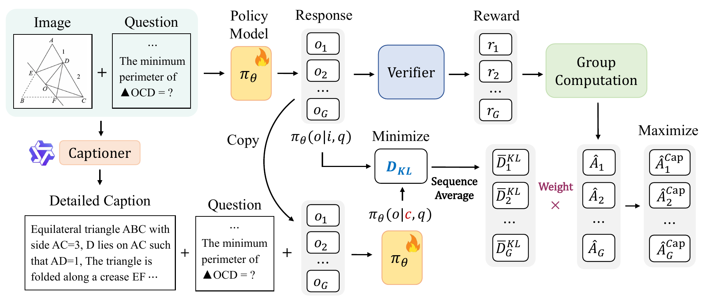

# CapPO: Caption-Regularized Policy Optimization

**Perception-Consistency Multimodal Large Language Models Reasoning via Caption-Regularized Policy Optimization**

Songjun Tu, Qichao Zhang, Jingbo Sun, Yuqian Fu, Linjing Li, Xiangyuan Lan,
Dongmei Jiang, Yaowei Wang, and Dongbin Zhao

[arXiv:2509.21854](https://arxiv.org/abs/2509.21854) · [PDF](https://arxiv.org/pdf/2509.21854) · [Citation](#citation)

CapPO extends GRPO with caption-based consistency regularization and
KL-weighted advantages. It compares the likelihood of the same response under
image and caption conditioning, and uses the disagreement to reweight the
policy update.

This repository provides the fixed CapPO training recipe, FSDP checkpoint
merging, and evaluation on ten benchmarks.

## 1. Prepare your inputs

Datasets, generated captions, model weights, and judge credentials are supplied
separately. Set the following paths to your own files.

| Input | Required for | What to prepare |
|---|---|---|
| Base model | Training | A local copy of [Qwen2.5-VL-7B-Instruct](https://huggingface.co/Qwen/Qwen2.5-VL-7B-Instruct), including model shards, tokenizer and processor files. |
| Captioned training set | Training | The cleaned **36,579-example** ViRL39K-derived JSONL and its images. The [ViRL39K source release](https://huggingface.co/datasets/PAPOGalaxy/PAPO_ViRL39K_train) provides the underlying data. The CapPO run used question-conditioned captions generated offline with Qwen2.5-VL-72B and filtered out missing or overlength captions and multi-image items. Supply a prepared captioned JSONL before training. |
| Validation set | Training | A JSONL and extracted images prepared from the [MathVision test split](https://huggingface.co/datasets/MathLLMs/MathVision). This is the training-time validation input. |
| CapPO checkpoint | Evaluation | The merged Hugging Face directory produced in Step 4, or an equivalent pretrained CapPO checkpoint you already have. |
| Benchmark data and judge credentials | Evaluation | The ten VLMEvalKit TSVs listed in Step 5, any referenced images, and your own API credential. |

The training loader expects one JSON object per line. Training rows use
**problem**, **answer**, **caption**, and **images**. Validation rows use
**problem**, **answer**, and **images**. Use strings for the text fields and a
list of paths for **images**. Paths are relative to the corresponding image root.
For example, an **images** value of **["images/example.jpg"]** resolves to the
**images/** subdirectory under **CAPPO_TRAIN_IMAGE_DIR**. Use the same caption
generation, filtering, and validation preprocessing to reproduce the original
data preparation.

## 2. Install

Use a Linux CUDA machine for training and evaluation. The archived training
environment used Python 3.10, PyTorch 2.7.0, vLLM 0.9.1 and Transformers 4.52.4.
Choose a PyTorch/CUDA installation supported by your GPU and driver. Install
FlashAttention against that PyTorch installation before installing the rest.

~~~bash
git clone https://github.com/TU2021/CapPO.git
cd CapPO
python3.10 -m venv .venv
source .venv/bin/activate
python -m pip install -U pip setuptools wheel packaging ninja
python -m pip install -c constraints-main.txt torch torchvision
python -m pip install -c constraints-main.txt --no-build-isolation flash-attn
python -m pip install -c constraints-main.txt -e .
python -m pip install -c constraints-main.txt -r VLMEvalKit/requirements.txt
~~~

FlashAttention may require a CUDA compiler or a wheel compatible with the
installed PyTorch, Python and CUDA versions.

## 3. Train the main experiment

Run the following from the repository root in the environment from Step 2.
Replace the example paths before running.

~~~bash
export CAPPO_PYTHON="$PWD/.venv/bin/python"
export CAPPO_MODEL_PATH=/path/to/Qwen2.5-VL-7B-Instruct
export CAPPO_TRAIN_FILE=/path/to/full-caption-train.jsonl
export CAPPO_TRAIN_IMAGE_DIR=/path/to/virl39k
export CAPPO_VAL_FILE=/path/to/MathVision_test.jsonl
export CAPPO_VAL_IMAGE_DIR=/path/to/MathVision/extracted
export CAPPO_GPUS=0,1,2,3,4,5,6,7
export CAPPO_CHECKPOINT_DIR="$PWD/runs/main"

CAPPO_PREFLIGHT_ONLY=true bash run_cappo.sh
bash run_cappo.sh
~~~

Run from a single node with eight GPUs. The fixed recipe uses the full training
set, seed 1, 150 steps, caption KL coefficient 0.01, and KL-based advantage
weighting with beta 0.10. It saves every 10 steps and keeps the latest two.
The preflight checks local paths. Full training requires the CUDA environment
and the actual input data.

## 4. Merge the checkpoint for evaluation

Use the training environment and sufficient CPU RAM. Pass the **actor/**
directory from a trusted CapPO training run. The exporter reads the FSDP
model shards in that directory and writes merged Hugging Face weights to its
**huggingface/** subdirectory, alongside the saved processor files.

~~~bash
python scripts/model_merger.py \
  --local_dir "$CAPPO_CHECKPOINT_DIR/global_step_150/actor"
export CAPPO_EVAL_MODEL="$CAPPO_CHECKPOINT_DIR/global_step_150/actor/huggingface"
~~~

If you already have a merged CapPO checkpoint, set **CAPPO_EVAL_MODEL** to its
directory and continue to Step 5.

## 5. Evaluate the merged model

Prepare the [VLMEvalKit](https://github.com/open-compass/VLMEvalKit) versions
of the benchmarks in one external directory. Put each TSV directly in that
directory under the exact filename below. Keep referenced image assets where
the dataset loaders expect them. The evaluator uses the supplied local TSVs.

| Math and reasoning | General reasoning |
|---|---|
| MathVista_MINI.tsv | LogicVista.tsv |
| MathVerse_MINI.tsv | ScienceQA_TEST.tsv |
| MathVision_MINI.tsv | MMStar.tsv |
| WeMath_COT.tsv | MMMU_DEV_VAL.tsv |
| DynaMath.tsv | MMMU_Pro_10c_COT.tsv |

**MathVision_MINI.tsv** is the reported benchmark input. Prepare it separately
from **MathVision_test.jsonl**, which the training launcher uses for validation.

~~~bash
export OPENAI_API_KEY=your_own_key
python evaluate.py \
  --model "$CAPPO_EVAL_MODEL" \
  --data-root /path/to/LMUData \
  --output-dir "$PWD/outputs/cappo-step150" \
  --gpus 0,1,2,3,4,5,6,7
~~~

Choose a new **--output-dir** for each run. Add **--dry-run** to validate paths
and print the protocol without inference or API calls. For a smaller smoke run,
add **--benchmarks MathVista_MINI** and choose one GPU with **--gpus 0**.
Evaluation uses one process and one model replica per selected GPU.

The launcher defaults to the local acceptance protocol. It uses gpt-4o-mini
for the five math benchmarks and LogicVista, and gpt-3.5-turbo for the other four.
If your API provider uses other compatible model names, set --math-judge and
--choice-judge explicitly. An alternate chat-completions endpoint is optional
via OPENAI_API_BASE. Report the actual judge and dataset fingerprints with any
results. The launcher writes protocol.json, per-benchmark predictions and
scoring artifacts, and scores.json under the selected output directory.

MMMU is reported on its **validation** split. The historical acceptance run used
a separately supplied 1,020-item dev/validation file. Its exact fingerprint
enables terminal-answer priority in the scorer. For the public MMMU dataset
or another version, the evaluator uses standard answer extraction. Report
the version, split and judge alongside the score.

## Citation

~~~bibtex
@misc{tu2025perceptionconsistencymultimodallargelanguage,
  title         = {Perception-Consistency Multimodal Large Language Models Reasoning via Caption-Regularized Policy Optimization},
  author        = {Songjun Tu and Qichao Zhang and Jingbo Sun and Yuqian Fu and Linjing Li and Xiangyuan Lan and Dongmei Jiang and Yaowei Wang and Dongbin Zhao},
  year          = {2025},
  eprint        = {2509.21854},
  archivePrefix = {arXiv},
  primaryClass  = {cs.MM},
  url           = {https://arxiv.org/abs/2509.21854}
}
~~~

## Acknowledgments

The training code is derived from EasyR1/veRL, and the evaluation code uses
VLMEvalKit. See the [training license](LICENSE), [evaluation license](VLMEvalKit/LICENSE),
and the source files for copyright notices.
